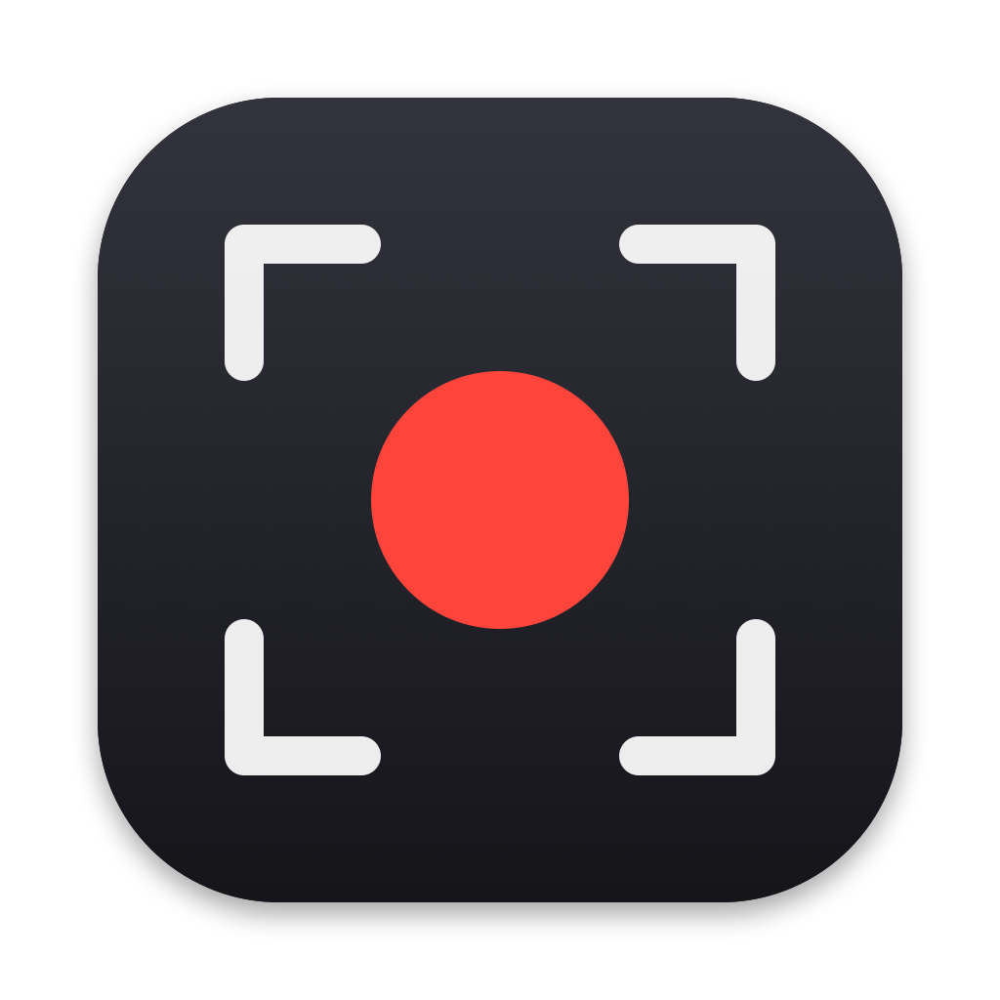

<p align="center">
  
</p>

<h1 align="center">Rec</h1>

<p align="center"><b>Record a screen region, paste the file path into your AI agent.</b></p>

Taking a screenshot is one shortcut. Recording your screen should be too. Rec is a small, free desktop app for people building with AI: press a shortcut, drag a box, and the recording starts. Click **Stop** and the video's path is on your clipboard, ready to paste into Claude Code, Codex, Cursor or any other agent.

```
/Users/you/Downloads/rec-2026-11-25-14-03-12.mp4
```

Your agent reads the video with ffmpeg (or any tool it likes) and sees exactly what you saw.

## How it works

1. **Press your shortcut** (⌃⇧5 by default; change it in Settings). A crosshair appears.
2. **Drag a box.** Recording starts the moment you let go. Esc, or a click without dragging, cancels.
3. **Click Stop** on the small pill floating next to the region. The pill is never in the video.
4. **Paste.** The MP4's absolute path is on your clipboard.

Recordings are silent H.264 MP4s at full Retina sharpness and 30 fps, with the mouse pointer visible. They go to your Downloads folder, or a folder you pick.

## Download

Get the latest version from [Releases](https://github.com/alexhemmingsen/rec/releases/latest):

| Platform | File | Notes |
| --- | --- | --- |
| macOS 14+ (Apple Silicon) | `Rec_<version>_aarch64.dmg` | Not notarized by Apple yet: the first time, macOS says it "could not verify" the app. Open **System Settings → Privacy & Security** and click **Open Anyway**. Once only. |
| Windows 10 (2004+) / 11 (x64) | `Rec_<version>_x64-setup.exe` | The installer isn't code-signed yet: if SmartScreen warns, click **More info → Run anyway**. |
| Linux (x64) | `Rec_<version>_amd64.deb` or `.AppImage` | See [Linux notes](#linux-notes). |

The first run walks you through permission (macOS), choosing a shortcut, checking for ffmpeg and making a practice recording. Updates install from inside Rec.

## Privacy

Everything stays on your computer. There's no account, no cloud and no analytics or crash reporting. The only network request Rec makes is the update check against this repository's GitHub Releases. It sends nothing about you or your recordings, and you can turn it off in Settings.

## The app

- **Overview:** a short guide.
- **Settings:** Screen Recording permission, the shortcut, the save folder, Open at login and the update check.
- **History:** every recording with a thumbnail, date and length. Copy the path again, open it, show it in Finder, or delete it (it goes to the Trash). Rec never deletes anything on its own.

Closing the window keeps Rec running, so the shortcut keeps working. Quit with ⌘Q.

## Platforms

One codebase ([Tauri 2](https://tauri.app) + Rust), with each platform's native capture:

- **macOS:** ScreenCaptureKit frames, hardware H.264 through AVFoundation. Rec leaves its own windows out of the video.
- **Windows:** Windows Graphics Capture, H.264 through Media Foundation. Rec's overlay and Stop pill are excluded from captures (`WDA_EXCLUDEFROMCAPTURE`).
- **Linux:** GStreamer. X11 sessions record directly; Wayland sessions go through the system's screen-sharing portal (PipeWire).

### Linux notes

- **Wayland:** the system asks which screen to share the first time you record; Rec remembers the answer. Rec's own windows run through XWayland so the overlay and pill can be placed. The shortcut is also registered through the desktop's GlobalShortcuts portal (GNOME 48+, KDE Plasma 5.27+); how well that works depends on your desktop.
- **Full-screen recordings show the Stop pill.** X11 and Wayland have no way to leave one window out of a screen capture, so when the region fills the screen the pill (which then has to sit inside it) is in the video. Leave a little room around the region to keep it out.
- **Encoder:** Rec needs an H.264 GStreamer encoder: x264 (`gstreamer1.0-plugins-ugly`) or OpenH264. The `.deb` pulls in what it needs; the AppImage bundles it.

## Tested end to end

CI drives the real app on all three platforms: it presses the shortcut, checks the overlay and Esc, drags a region, clicks Stop, reads the clipboard and inspects the MP4 (codec, size, length). On Windows it also records the whole screen and checks that the Stop pill isn't in the video. GitHub's virtual Macs drop scripted mouse drags, so on macOS CI covers the shortcut, overlay, Esc and real screen capture, and the drag-to-record flow is checked on a real Mac. See `e2e/`.

## Building from source

You need Rust (stable), Node.js 22+ and pnpm.

```sh
pnpm install
pnpm tauri dev          # run the app with hot reload
pnpm test               # frontend unit tests
cargo test --workspace  # Rust tests, including real H.264 encoding
pnpm tauri build        # Rec.app and a DMG in target/release/bundle
```

When you run from a terminal, macOS attributes screen recording to the terminal app, so grant Screen Recording to it (or test with the built `Rec.app`). On Linux you need the GStreamer development packages (`libgstreamer1.0-dev libgstreamer-plugins-base1.0-dev`) plus Tauri's usual WebKitGTK ones. `scripts/release-macos.sh` builds the signed release artifacts; see `AGENTS.md` for the layout of the code.

## License

[MIT](LICENSE)
